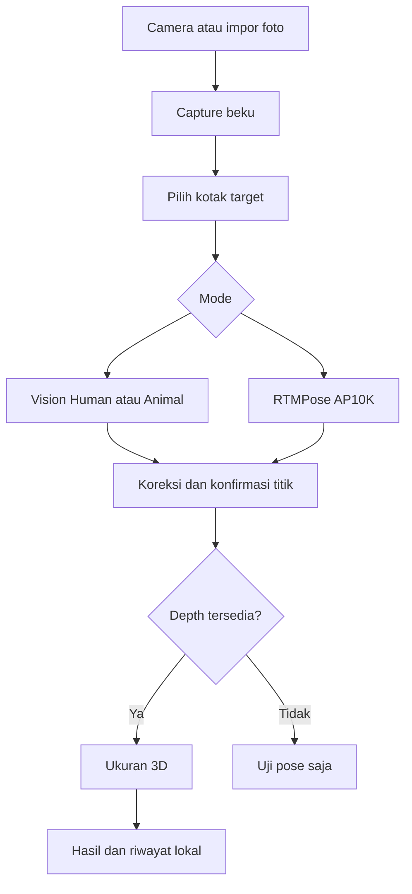

# Arsitektur dan aliran data

`SapiMeasureApp.swift` memiliki Home, Camera, dan History. `ReviewScreen.swift` menampilkan satu capture; `ReviewModel.swift` mengatur transisinya.

| File | Tanggung jawab | Mengapa dipisah |
|---|---|---|
| `CaptureService.swift` | Otorisasi kamera, lifecycle ARSession, snapshot RGB/depth/intrinsics | Kamera tetap independen dari model pose dan rumus. |
| `PoseService.swift` | Vision atau RTMPose; mengembalikan landmark berlabel, koordinat dan skor | Model bisa diganti di Iterasi 2 dengan UI yang sama. |
| `ReviewModel.swift` | Area target, kandidat titik, koreksi, konfirmasi, perhitungan | Mencegah hasil lama dipakai setelah titik berubah. |
| `PhotoCanvas.swift` | Aspect-fit foto, transformasi sentuhan, overlay, drag | Koordinat layar harus kembali tepat ke piksel foto. |
| `MeasurementCore.swift` | Sampling depth, unprojection, panjang, fit ellipse, Winter | Fungsi geometri dapat diuji tanpa ARKit. |
| `HistoryStore.swift` | Penyimpanan atomik, restore, delete | Data dapat dianalisis ulang saat model/metode berubah. |

## Kontrak koordinat

Semua `Point2` adalah normalisasi 0–1 pada foto portrait tegak, origin kiri atas. Pose Vision memakai origin kiri bawah; provider membalik y sebelum memberi hasil. Hasil RTMPose kembali melalui transform crop yang sama saat preprocessing.

RGB ARFrame mentah diputar `.right` untuk foto portrait. Depth tidak diputar. Inverse: `raw.u = portrait.y`, `raw.v = 1 - portrait.x`. `CameraCalibration` mempertahankan fx/fy/cx/cy pada resolusi RGB mentah. Unprojection memakai piksel RGB mentah dan z dari map depth beresolusi lebih rendah.

Panjang menggunakan koordinat kamera (x kanan, y bawah, z maju), bukan koordinat world. Jarak tetap invarian terhadap rotasi kamera. Snapshot menyimpan transform world untuk analisis selanjutnya.

## State dan invalidasi

Capture → pilih target → inferensi atau manual → titik lengkap → konfirmasi → hitung → simpan.

Mengubah area menghapus kandidat dan hasil. Menggeser titik membatalkan konfirmasi dan hasil. Foto impor tidak punya depth sehingga tidak dapat menghasilkan cm/kg. Inferensi berjalan pada queue khusus; tampilan menerima callback pada main queue. Capture menyalin buffer supaya tidak menyimpan frame ARKit terus-menerus. Session dipause pada review/background.

## Model dan data

RTMPose menerima RGB float NCHW [1,3,256,256], mean/std ImageNet 0–255. Area target diperbesar 1.25 kali dan dibuat persegi tanpa distorsi aspect ratio. Output SimCC [1,17,512] di-decode dengan argmax per sumbu; indeks dibagi dua lalu dipetakan balik ke crop. Skor ini bukan probabilitas akurasi ukuran.

AP10K mempunyai shoulder dan hip; hip tidak sama dengan pin/ischium. Kandidat tersebut diberi provenance `model-proxy-needs-review`. Titik dada ditempatkan manual. Catatan sumber tetap tersimpan; pose awal tidak ditimpa saat landmark ukur dikoreksi.

`capture.json` memuat metadata dan depth. `result.json` memuat hasil, landmarks koreksi, pose model, target rectangle, mode, ID/bangsa opsional, dan versi formula. `photo.jpg` menyimpan foto. Semua berada di Application Support/SapiMeasure, satu direktori per hasil. Hapus riwayat menghapus ketiga file.
